# âš¡ Multi-Agentic Energy Trading

### Autonomous P2P Energy Orchestration for India's Rooftop Solar Grid

> **⚠️ This folder contains ONLY startup documentation, assets, and non-code materials.**
> **DO NOT modify any code in `backend/`, `frontend/`, or `blockchain/`.**

---

## 🔗 Quick Links

| | Link |
|---|---|
| 🌐 **Live Proof of Concept** | [p2p-trading.vercel.app](https://p2p-trading-nrj4iz7e0-abhirajs-projects-1d7aabae.vercel.app/) |
| 🎬 **Video Demo** | [Google Drive](https://drive.google.com/file/d/17HzW5DpCWRaoFsLILpnOXY-AOs39rTaz/view?usp=drivesdk) |

---

## 🔴 The Challenge

Rooftop solar generation in India reached approximately **20.8 GW** of cumulative installed capacity by end-2025, yet grid operators were forced to discard an estimated **2.3 TWh** of that energy while simultaneously paying out an estimated **₹6,000 crore** in must-run compensation — **not because demand was absent, but because neighboring households had no way to trade directly.**

Traditional auction systems using cloud technology and public-chain blockchains cannot fulfill the latency and privacy requirements of residential trading.

### What We Built

A complete **local-edge energy trading system** where:
- 🤖 An autonomous **multi-agent engine** negotiates real-time prices
- 🛰️ **Satellite-informed** agent predictions forecast household supply
- âš¡ Buyer and seller bids are matched within **physical grid capacity constraints**
- 🔗 Every settlement is permanently recorded using a **dual-tier local blockchain**

### Results

| Metric | Value |
|--------|-------|
| **Solar Curtailment Reduction** | 20% |
| **Cluster Efficiency Improvement** | 22.5% |
| **Trade Latency** | 340ms _(vs 14,200ms blockchain baseline)_ |
| **Privacy Compliance** | Full (DPDP Act 2023) |
| **Federated Learning MAE** | 0.18 kWh / 15-min window |

---

## 🏗️ System Architecture

The proposed system is a **decentralized, edge-based peer-to-peer energy trading framework**. It consists of a shared cluster server, multiple household nodes, a local communication network, and integrated forecasting and blockchain components.

### Software Architecture — 4-Layer Design

The architecture enables real-time monitoring, intelligent decision-making, and secure energy transactions within a residential cluster.

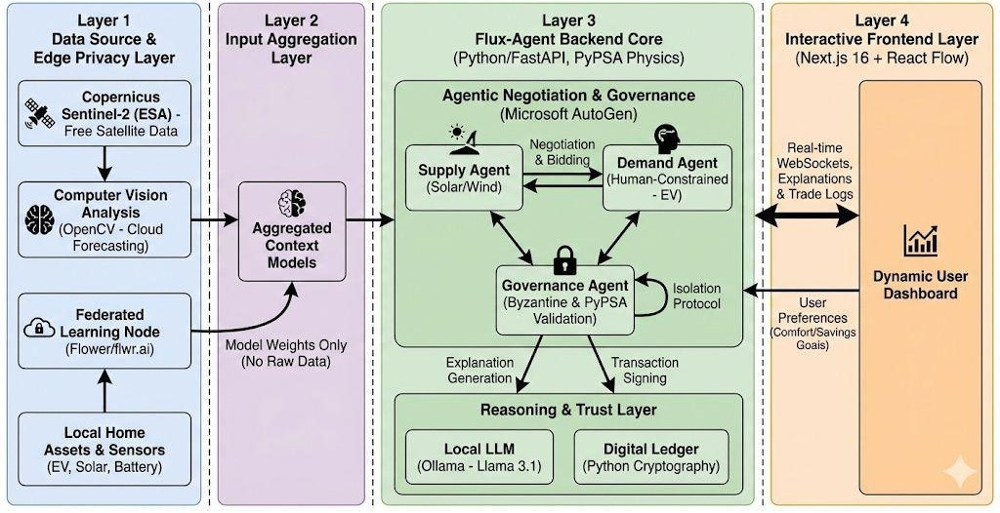

**Layer 1 — Data Source & Edge Privacy Layer**
- Copernicus Sentinel-2 (ESA) free satellite data
- Computer Vision Analysis (OpenCV — Cloud Forecasting)
- Federated Learning Nodes (Flower/flwr.ai)
- Local Home Assets & Sensors (EV, Solar, Battery)

**Layer 2 — Input Aggregation Layer**
- Aggregated Context Models
- Model weights only — **no raw data** leaves the device

**Layer 3 — Flux-Agent Backend Core**
- Supply Agent (Solar/Wind) ↔ Demand Agent (Human-Constrained, EV)
- Governance Agent (Byzantine & PyPSA Validation)
- Reasoning & Trust Layer: Local LLM (Ollama — LLaMA 3.1) + Digital Ledger

**Layer 4 — Interactive Frontend Layer**
- Next.js 16 + React Flow
- Real-time WebSockets, Explanations & Trade Logs
- User Preferences (Comfort/Savings Goals)

---

### Hardware Architecture — Cluster & Node Design

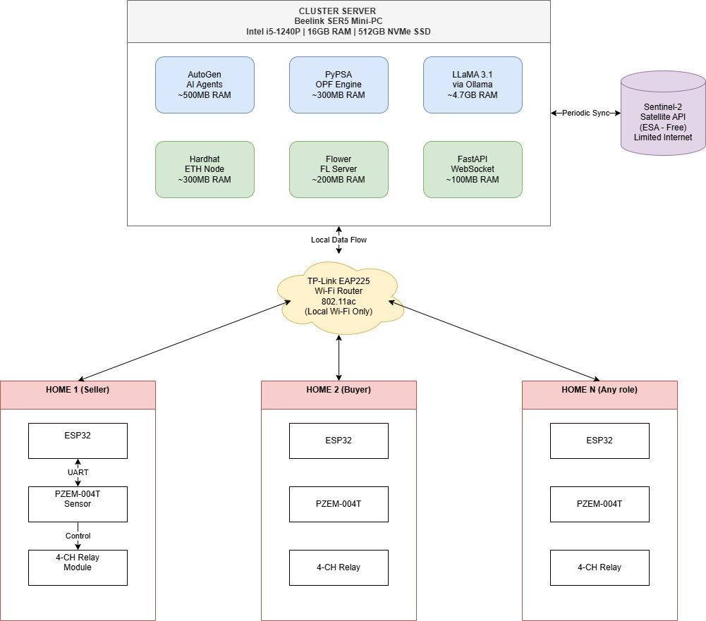

The cluster server (Beelink SER5 Mini-PC) hosts all major computational modules:

| Module | RAM Usage | Function |
|--------|-----------|----------|
| AutoGen AI Agents | ~500MB | Multi-agent negotiation engine |
| PyPSA OPF Engine | ~300MB | Optimal power flow / grid physics |
| LLaMA 3.1 via Ollama | ~4.7GB | On-device LLM for explainability |
| Hardhat ETH Node | ~300MB | Local blockchain & smart contracts |
| Flower FL Server | ~200MB | Federated learning coordination |
| FastAPI WebSocket | ~100MB | Real-time communication server |

---

### Network Topology — Physical, Cyber & Transactional Layers

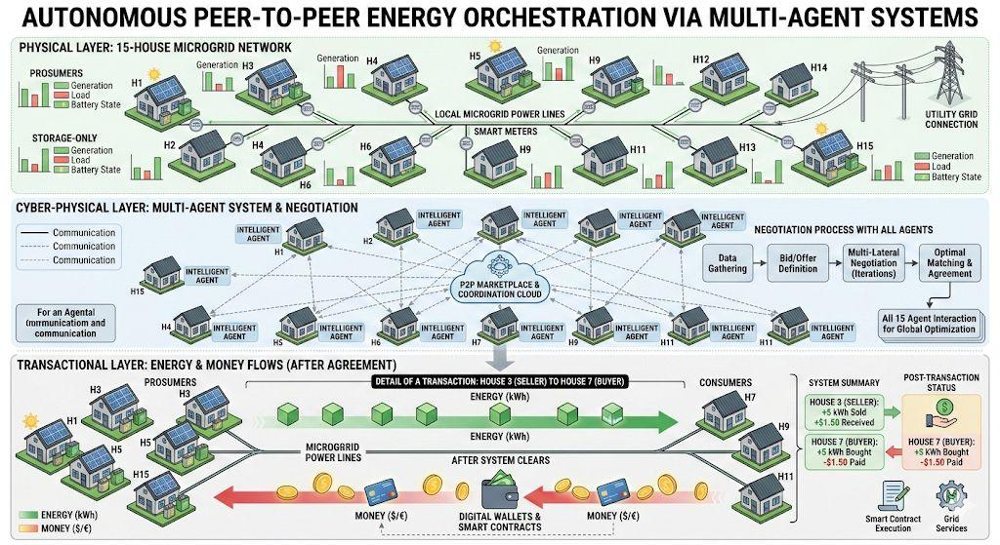

The topology diagram shows three layers working in concert:

1. **Physical Layer** — 15-house microgrid network with prosumers (generation + load + battery) and storage-only nodes, connected via local microgrid power lines and smart meters
2. **Cyber-Physical Layer** — Each home has an intelligent agent connected to the P2P Marketplace & Coordination Cloud. The negotiation process: Data Gathering → Bid/Offer Definition → Multi-Lateral Negotiation → Optimal Matching & Agreement
3. **Transactional Layer** — Energy flows from prosumers to consumers via microgrid power lines, while money flows through digital wallets & smart contracts

---

## 💰 Cost Analysis

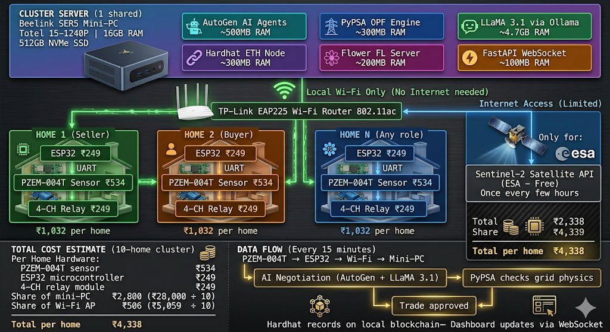

### Per-Household Hardware Cost

| Component | Cost (INR) |
|-----------|-----------|
| PZEM-004T Energy Sensor | ₹534 |
| ESP32 Microcontroller | ₹249 |
| 4-Channel Relay Module | ₹249 |
| Share of Mini-PC (₹28,000 ÷ 10) | ₹2,800 |
| Share of Wi-Fi AP (₹5,059 ÷ 10) | ₹506 |
| **Total Cost per Household** | **₹4,338** |

### Shared Infrastructure Cost (10-home cluster)

| Component | Total Cost (INR) |
|-----------|-----------------|
| Beelink SER5 Mini-PC Server | ₹28,000 |
| TP-Link EAP225 Wi-Fi Access Point | ₹5,059 |

---

## 🔧 Detailed Hardware Components

### 1. Cluster Server — Beelink SER5 Mini-PC

The cluster server acts as the **central processing unit** and hosts all major computational modules required for system operation. It performs forecasting, negotiation, validation, communication, and transaction recording.

#### Internal Components:

**a. Multi-Agent AI Engine**
- Implements autonomous agents representing each household
- Performs real-time negotiation between buyers and sellers
- Determines optimal pricing and trading decisions

**b. Language Model Module (LLaMA 3.1)**
- Supports intelligent reasoning and coordination among agents
- Enhances negotiation strategies and adaptive decision-making

**c. Federated Learning Server (Flower)**
- Trains forecasting models using distributed household data
- Preserves privacy by avoiding raw data sharing
- Improves prediction accuracy over time

**d. Power System Analysis Engine (PyPSA)**
- Performs optimal power flow analysis
- Verifies whether proposed trades are physically feasible
- Ensures grid safety and stability

**e. Blockchain Node (Local Ethereum via Hardhat)**
- Maintains a private blockchain within the local network
- Records all approved energy transactions
- Ensures transparency, immutability, and trust

**f. Real-Time Communication Server (FastAPI + WebSocket)**
- Enables live updates between server and household nodes
- Supports dashboard and monitoring interfaces
- Ensures low-latency data exchange

### 2. Household Nodes

Each household acts as an **independent participant** in the energy trading network.

| Component | Function |
|-----------|----------|
| **ESP32-WROOM-32** | Main controller — handles communication with cluster server, executes control commands |
| **PZEM-004T v3.0** | Measures voltage, current, and power — provides real-time energy data |
| **4-CH Relay Module** | Controls electrical loads — executes switching based on trading outcomes |

### 3. Communication Network

**Device:** TP-Link EAP225 Wi-Fi Router (802.11ac)
- Connects all household nodes to the cluster server
- Operates within a **local network only** — no external internet dependency
- Provides fast and reliable communication

### 4. Satellite Data Integration

**Source:** Sentinel-2 Satellite API (ESA — Free)
- Supplies environmental and solar irradiance data
- Enhances forecasting accuracy for solar energy generation
- Accessed periodically (once every few hours) rather than continuously

---

## 🔄 Energy Trading Workflow

The system operates in **15-minute intervals**. Here's the step-by-step process:

```
┌─────────────────────────────────────────────────────────────────┐
│  PZEM-004T → ESP32 → Wi-Fi → Mini-PC (every 15 minutes)       │
│                                                                 │
│  1. 📊 Energy data measured by PZEM-004T sensor                │
│  2. 📡 ESP32 transmits data to cluster server via Wi-Fi        │
│  3. 🔮 Forecasting models estimate demand + solar generation   │
│  4. 🤖 AI agents negotiate energy trades (AutoGen + LLaMA 3.1) │
│  5. ⚡ PyPSA validates grid feasibility (IEEE 33-bus model)    │
│  6. ✅ Approved trades are finalized                           │
│  7. 🔗 Transactions recorded on local blockchain (Hardhat)     │
│  8. 📱 Dashboard updates via WebSocket in real-time            │
└─────────────────────────────────────────────────────────────────┘
```

---

## 🖥️ Hardware Simulation (Wokwi)

ESP32 + PZEM-004T + 4-CH Relay simulation using Wokwi online simulator:

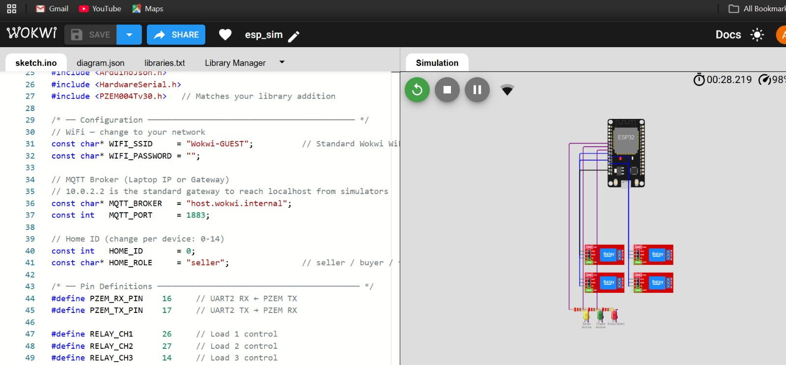

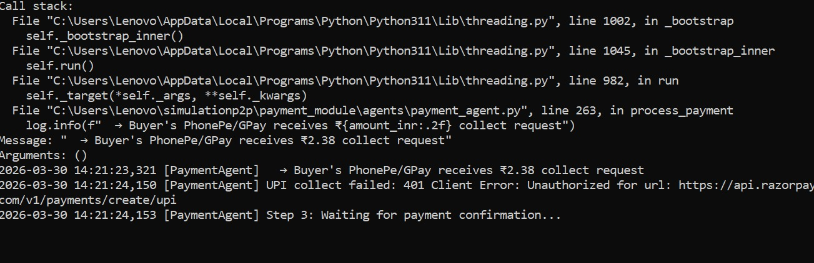

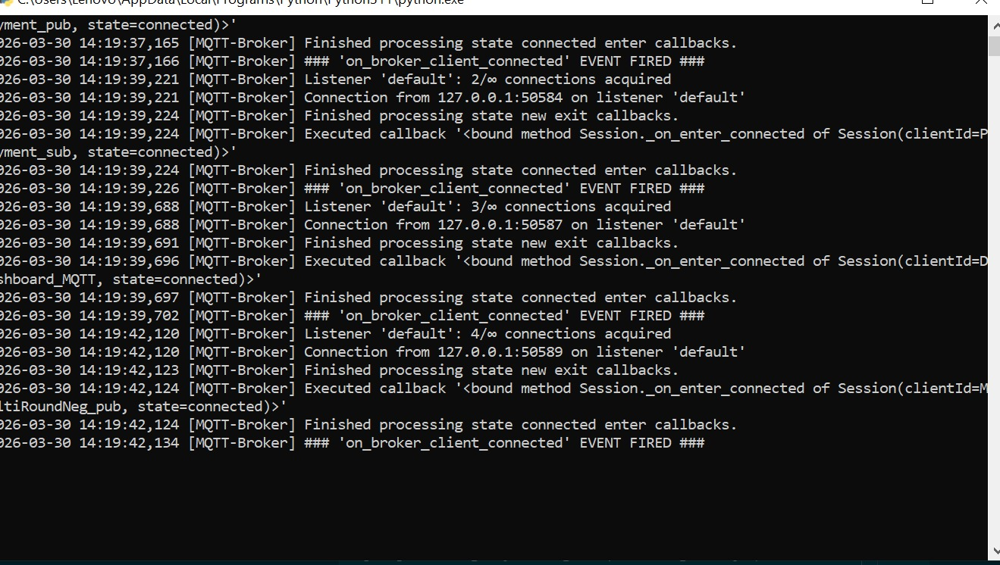

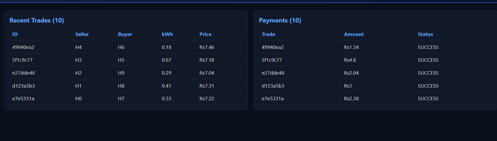

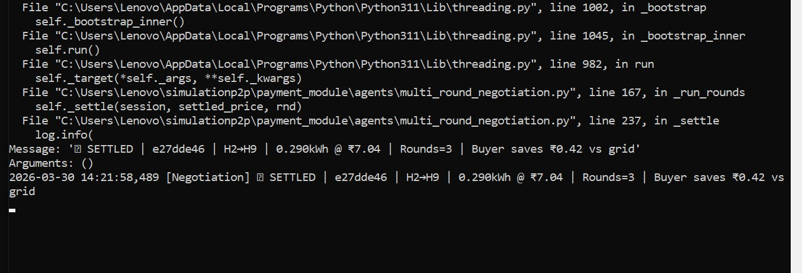

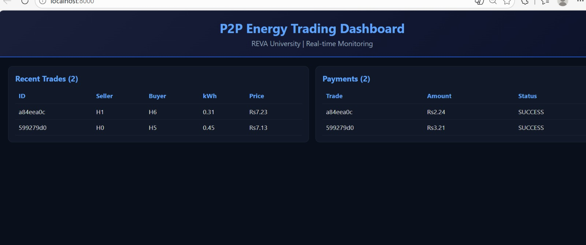

---

## 📸 Live Platform Demo — FluxCore Energy Orchestrator

### Dashboard — Main Operations

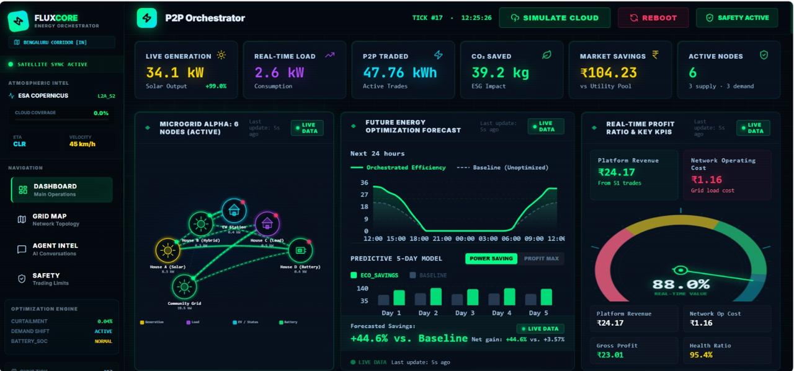

Key real-time metrics displayed:
- **Live Generation:** 34.1 kW Solar Output
- **P2P Traded:** 47.76 kWh across active trades
- **COâ‚‚ Saved:** 39.2 kg ESG impact
- **Market Savings:** ₹104.23 vs utility pool
- **Active Nodes:** 6 (3 supply + 3 demand)
- **Efficiency Gain:** +44.6% vs. Baseline

---

### Grid Topology & Flow Map

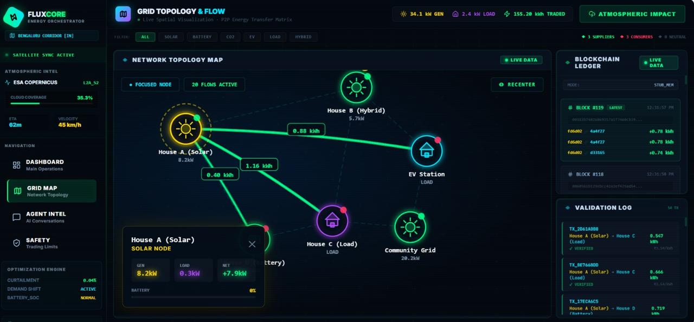

Live spatial visualization of the P2P energy transfer matrix:
- Node types: Solar, Hybrid, Load, EV, Battery
- Real-time energy flow quantities (kWh) on each link
- Blockchain ledger showing latest blocks and settlement entries
- Validation log with verified transactions

---

### Agent Intel & Negotiations

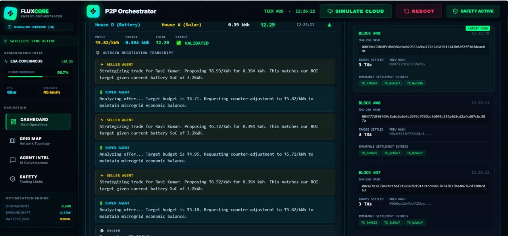

The AutoGen negotiation transcript shows:
- **Seller Agent** proposes trade prices based on ROI targets and battery SoC
- **Buyer Agent** analyzes offers, requests counter-adjustments for microgrid balance
- Multiple rounds of negotiation converge to mutually beneficial prices
- Each settlement recorded in blockchain blocks with SHA-256 hashes

---

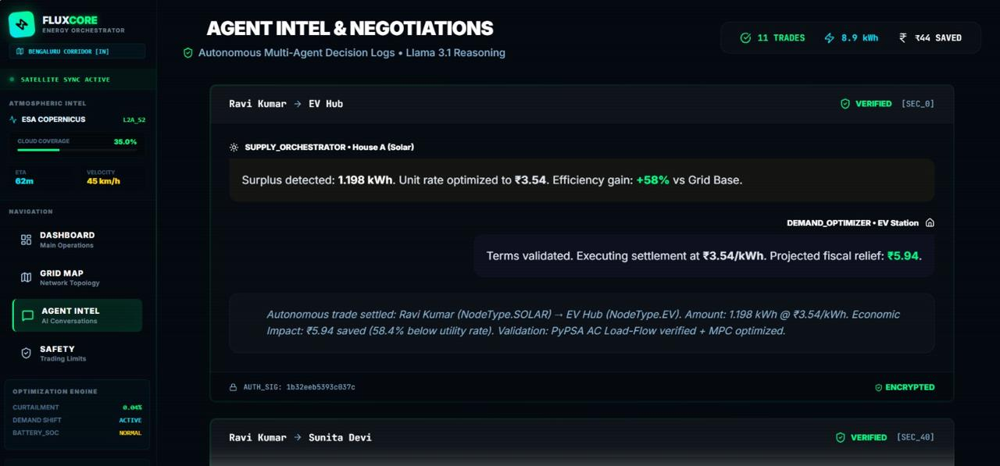

Detailed trade settlement view:
- **Supply Orchestrator** detects surplus (1.198 kWh) and optimizes unit rate to ₹3.54
- **Demand Optimizer** validates terms and executes settlement
- Efficiency gain: **+58% vs Grid Base**
- Validation: PyPSA AC Load-Flow verified + MPC optimized
- Cryptographic signatures ensure non-repudiation

---

### Safety & Trading Limits

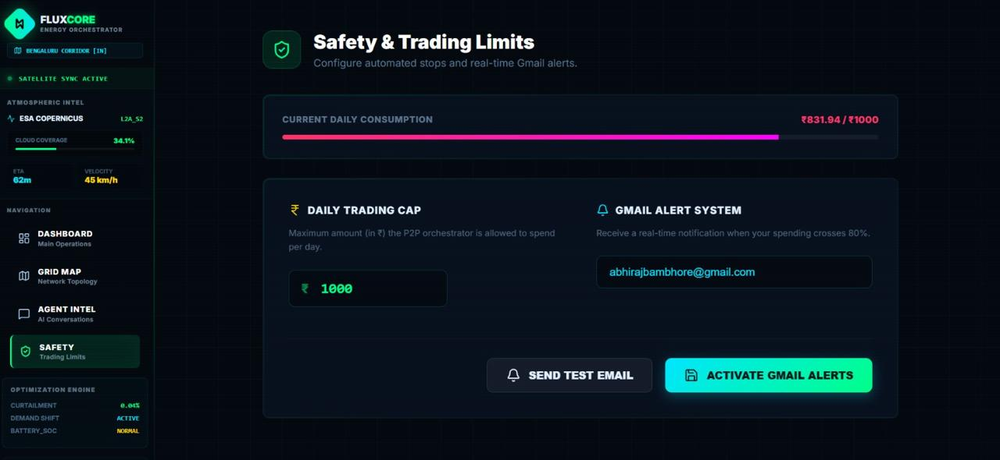

Consumer protection features:
- **Daily Trading Cap** — Maximum ₹ the P2P orchestrator can spend per day
- **Gmail Alert System** — Real-time notification when spending crosses 80%
- **Current Consumption Tracking** — Live progress bar (₹831.94 / ₹1000)

---

## 📊 Performance Comparison

| Metric | Centralized | Blockchain P2P | **Proposed (Ours)** |
|--------|-------------|----------------|---------------------|
| Efficiency Gain (%) | 14.2 | 16.8 | **22.5** |
| Curtailment Reduction (%) | 8.5 | 11.2 | **20.0** |
| Trade Latency (ms) | 510 | 14,200 | **340** |
| Privacy Compliance | No | Partial | **Full** |
| FL MAE (kWh) | N/A | N/A | **0.18** |
| OPF Governance | No | No | **Yes** |
| XAI Explanation | No | No | **Yes** |

---

## 📂 Folder Structure

```
startup_details/
│
├── 📐 architecture/
│   ├── software/software_architecture.jpeg
│   ├── hardware/hardware_architecture.jpeg
│   └── topology/topology_overview.jpeg
│
├── 📸 demo_screenshots/
│   ├── dashboard/01_main_dashboard.jpeg
│   ├── grid_map/02_grid_topology_map.jpeg
│   ├── agent_intel/03_agent_negotiations.jpeg
│   ├── agent_intel/05_agent_intel_detail.jpeg
│   └── safety/04_safety_trading_limits.jpeg
│
├── 🔧 hardware_simulation/
│   ├── 01_wokwi_esp32_code.jpeg
│   ├── 02_wokwi_simulation.jpeg
│   ├── 03_wokwi_circuit.jpeg
│   ├── 04_simulation_output.jpeg
│   ├── 05_simulation_detail.jpeg
│   └── 06_simulation_result.jpeg
│
├── 📊 presentations/
│   ├── India_P2P_Energy_Startup.pptx
│   ├── MirageX_Multi_Agentic_Energy_Trading.pptx
│   ├── Multi_Agentic_Energy_Trading_Full.pptx
│   └── Flux_Project_Startup_Final.pptx
│
├── 💰 cost_analysis/
│   └── cost_and_implementation_details.jpeg
│
├── 📋 business_strategy/
│   ├── Startup_Evaluation_Indian_Energy_Stack.docx
│   ├── research_paper_content.txt
│   └── paul_graham_validation_framework.txt
│
├── 🔗 links_and_references/
│   └── links.md
│
└── 📖 README.md  ← You are here
```

---

## 📝 Summary

The system integrates **edge computing**, **IoT devices**, **multi-agent intelligence**, and **blockchain technology** to enable decentralized energy trading. It ensures:

- âš¡ **Efficient utilization** of renewable energy
- 🤖 **Real-time decision-making** via autonomous agents
- 🔒 **Secure transaction handling** with dual-tier blockchain
- 🏠 **Scalable deployment** within local communities
- 🔐 **Full privacy compliance** with India's DPDP Act 2023

---

> 📌 **Built by:** Abhiraj Bambhore | abhirajbambhore@gmail.com
> 📌 **Institution:** School of Computer Science and Engineering, REVA University, Bangalore
> 📌 **Last updated:** July 2026

